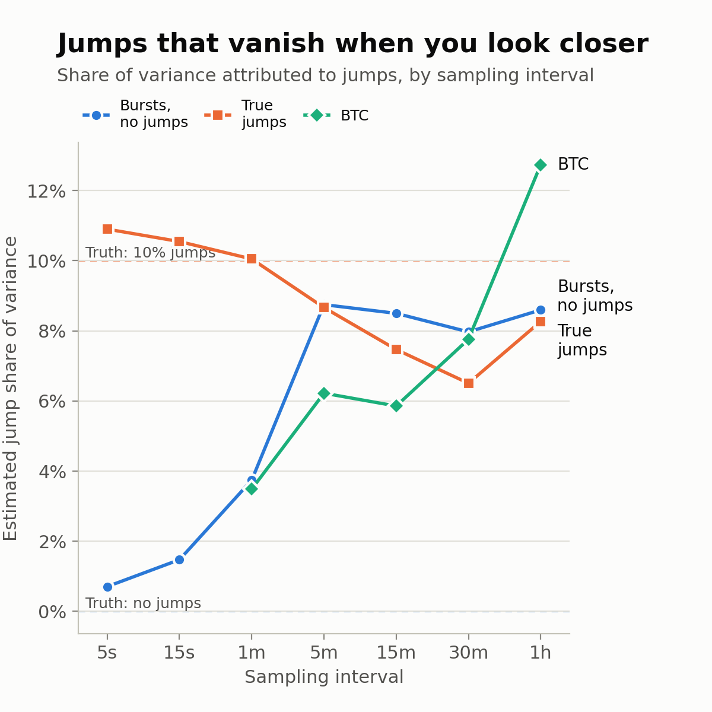
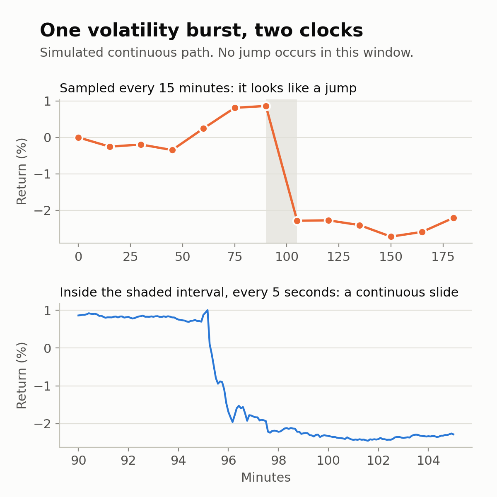
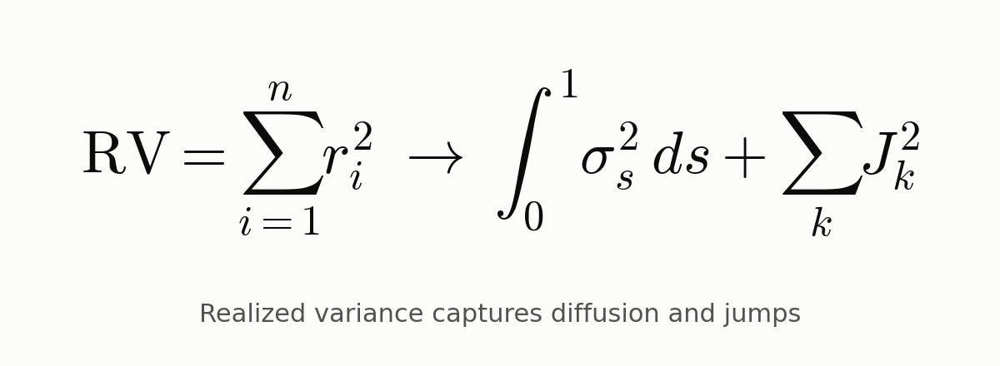
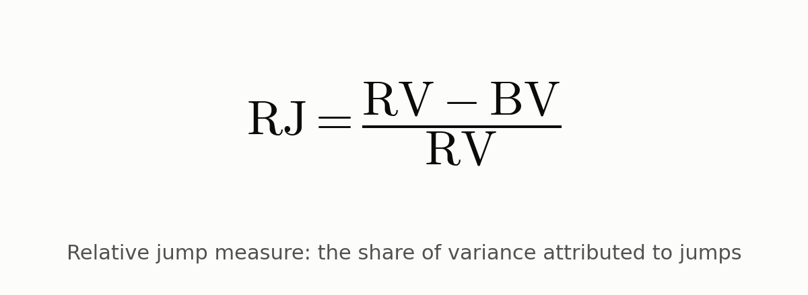

<p align="center">
  
</p>

<h1 align="center">Jumps in financial time series</h1>

<p align="center">
  The code and notebooks behind a six-part LinkedIn series on jumps:<br>
  how to detect them, how to model them, and what they do to option prices and hedges.
</p>

<p align="center">
  <a href="#the-series">Posts</a> ·
  <a href="#run-it-yourself">Run it</a> ·
  <a href="#how-the-code-is-organised">Code</a>
</p>

---

Every post pairs a **controlled simulation**, where the truth about jumps is known, with
**BTC and ETH data** that anyone can download without an account. The notebooks produce
every number and figure quoted in the posts, so you can check them, change the assumptions,
or run them on your own data.

## The series

| # | Post | Question it answers | Code |
|:-:|------|---------------------|------|
| 1 | **Most "jumps" are not jumps** | Are detected jumps real, or volatility bursts seen on a coarse clock? | [notebook](notebooks/01_jumps_vs_vol_bursts.ipynb) · [draft](posts/01_post.md) |
| 2 | Why jump tests over-reject | Microstructure noise and intraday periodicity on a fine grid | planned |
| 3 | Finite or infinite activity? | Are there a few big jumps, or infinitely many small ones? | planned |
| 4 | Jumps versus rough volatility | Which one explains the short-dated skew? | planned |
| 5 | The jump risk premium | What the market pays to be rid of them | planned |
| 6 | Hedging when jumps self-excite | Hawkes dynamics and what they do to a hedge | planned |

### Post 1 in one picture

A volatility burst lasting a couple of minutes is a continuous move. Sampled every
15 minutes, it lands inside a single return and the standard bipower-variation test
calls it a jump.

<p align="center">
  
</p>

The estimators, for reference (LinkedIn does not render LaTeX, so these are exported as images from the notebook):

| Realized variance | Bipower variation | Relative jump measure |
|:-:|:-:|:-:|
|  |  |  |

## Run it yourself

```bash
git clone https://github.com/PascalLemieux/jumps.git && cd jumps
conda create -n jumps python=3.12 -y && conda activate jumps   # or any virtualenv
pip install -r requirements.txt
jupyter lab notebooks/
```

The first run of a notebook downloads 1-minute bars from Binance's public archive at
[`data.binance.vision`](https://data.binance.vision) (no API key) and caches them as
parquet under `data/`, which is git-ignored. Two years of one symbol is about 60 MB.
If the archive is unreachable the notebooks skip the empirical section and still run
the simulations.

```python
from jumps.data import load_klines, to_daily_grid
from jumps.estimators import bns_jump_test, subsample_returns

btc = load_klines("BTCUSDT", "2023-01", "2024-12")        # 1-minute OHLCV, UTC index
grid = to_daily_grid(btc["close"])                         # (day x minute) log prices
res = bns_jump_test(subsample_returns(grid.to_numpy(), 5)) # 5-minute returns
res["rj"]                                                  # jump share of variance, per day
```

To use your own data, build a `pd.Series` of 1-minute closes indexed by UTC time and
pass it to `to_daily_grid`.

## How the code is organised

```
notebooks/   one notebook per post; each regenerates its figures
posts/       the LinkedIn post drafts
figures/     exported charts and equation images, sized for LinkedIn (1200 x 1200)
src/jumps/
  data.py        Binance archive downloader, parquet cache, daily grid builder
  simulate.py    price paths with known jump content (volatility bursts vs real jumps)
  estimators.py  realized variance, bipower variation, tripower quarticity, BNS test
  plotting.py    the series' figure style and chart helpers
```

The package is deliberately small and dependency-light (numpy, pandas, scipy, matplotlib,
pyarrow). It is not published on PyPI; the notebooks add `src/` to the path.

## References

- Barndorff-Nielsen, O. E. and Shephard, N. (2004). Power and bipower variation with stochastic volatility and jumps. *Journal of Financial Econometrics*.
- Barndorff-Nielsen, O. E. and Shephard, N. (2006). Econometrics of testing for jumps in financial economics using bipower variation. *Journal of Financial Econometrics*.
- Huang, X. and Tauchen, G. (2005). The relative contribution of jumps to total price variance. *Journal of Financial Econometrics*.
- Christensen, K., Oomen, R. C. A. and Podolskij, M. (2014). Fact or friction: Jumps at ultra high frequency. *Journal of Financial Economics*.

## License

MIT. See [LICENSE](LICENSE). If you use the code or figures, a link back is appreciated.
