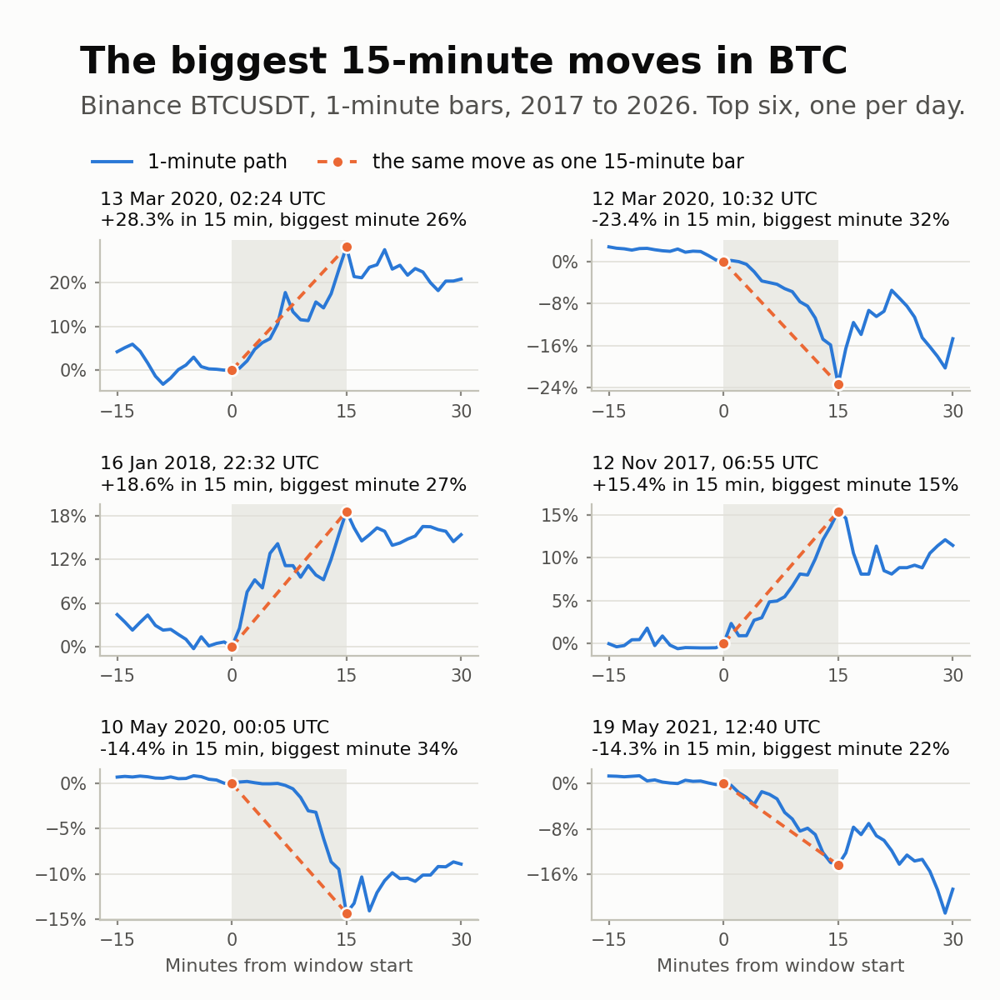
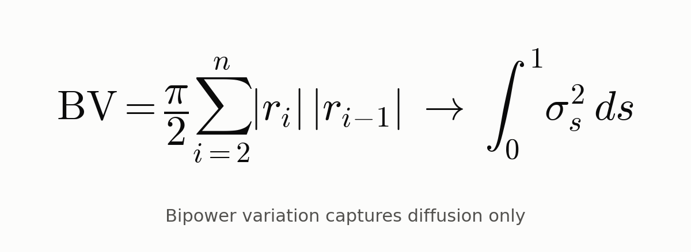
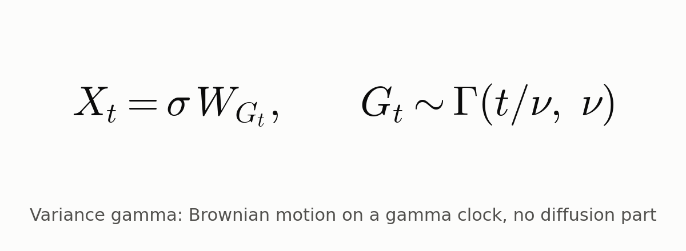

<p align="center">
  
</p>

<h1 align="center">Jumps in financial time series</h1>

<p align="center">
  The code and notebooks behind a nine-part LinkedIn series on jumps:<br>
  how to detect them, how to model them, and what they do to option prices and hedges.
</p>

<p align="center">
  <a href="https://www.linkedin.com/in/pascal-lemieux/">Follow the series on LinkedIn</a> ·
  <a href="#the-series">Posts</a> ·
  <a href="#run-it-yourself">Run it</a> ·
  <a href="#how-the-code-is-organised">Code</a>
</p>

---

> Pascal Lemieux is a quant with 15+ years across J.P. Morgan, RBC, Société Générale and First Abu Dhabi Bank, spanning structured products, derivatives pricing and volatility modelling. He now focuses on digital-asset derivatives: crypto options, volatility surfaces and hedging, including deep reinforcement learning for hedging and execution, work he began as co-founder of Affresco. M.Sc. Financial Mathematics, Bayes Business School. [LinkedIn](https://linkedin.com/in/pascal-lemieux)

This series tests what the jump literature claims against crypto market data, from 1-minute bars to tick trades. Every result is reproducible from the code in this repo. Every post asks the same question of a different effect: **is it real, or is it the
measurement?** Empirical evidence leads, with simulation kept to a small sanity check. Data
comes from Binance's public archive, which anyone can download without an account.

## The series

| # | Post | Question it answers | Code |
|:-:|------|---------------------|------|
| 1 | **Most "jumps" are not jumps** | Are the biggest moves discontinuities, or slides that bars cannot resolve? | [notebook](notebooks/01_jumps_vs_vol_bursts.ipynb) · [draft](posts/01_post.md) |
| 2 | Intraday seasonality and false jumps | How many detections are just the busy hours of the day? | planned |
| 3 | Bid-ask bounce and microstructure noise | What tick data does to jump tests, and how to average the noise out | planned |
| 4 | Finite or infinite activity | A few big jumps, or an endless stream of small ones? | planned |
| 5 | What jump activity does to your hedge | How much risk delta hedging can remove, and how fast | planned |
| 6 | Is volatility rough? | Is the clean scaling line real, or a measurement artefact? | planned |
| 7 | Jumps or roughness in the smile? | Which one explains the short-dated skew? | planned |
| 8 | The jump risk premium | What the market pays to be rid of them | planned |
| 9 | Hedging with self-exciting jumps | Hawkes dynamics, co-jumps, and the cross-section of coins | planned |

### Post 1 in one picture

The six largest 15-minute moves in Bitcoin's history, seen at 1-minute resolution, are
slides that take five to fourteen minutes to cover half the distance. On a 15-minute
chart each is one candle, and the standard bipower-variation jump test books the whole
candle to the jump component. Its verdict then depends on the bar size:

<p align="center">
  
</p>

The estimators, for reference (LinkedIn does not render LaTeX, so these are exported as images from the notebook):

| Realized variance | Bipower variation | Relative jump measure | Variance gamma |
|:-:|:-:|:-:|:-:|
|  |  |  |  |

## Run it yourself

```bash
git clone https://github.com/PascalLemieux/jumps.git && cd jumps
conda create -n jumps python=3.12 -y && conda activate jumps   # or any virtualenv
pip install -r requirements.txt
jupyter lab notebooks/
```

The first run of a notebook downloads 1-minute bars from Binance's public archive at
[`data.binance.vision`](https://data.binance.vision) (no API key) and caches them as
parquet under `data/`, which is git-ignored. The full BTC and ETH history, August 2017
to date, is about 440 MB and takes a few minutes.

```python
from jumps.data import load_klines, to_daily_grid
from jumps.estimators import bns_jump_test, subsample_returns

btc = load_klines("BTCUSDT", "2023-01", "2024-12")        # 1-minute OHLCV, UTC index
grid = to_daily_grid(btc["close"])                         # (day x minute) log prices
res = bns_jump_test(subsample_returns(grid.to_numpy(), 5)) # 5-minute returns
res["rj"]                                                  # jump share of variance, per day
```

To use your own data, build a `pd.Series` of 1-minute closes indexed by UTC time and
pass it to `to_daily_grid`.

## How the code is organised

```
notebooks/   one notebook per post; each regenerates its figures
posts/       the LinkedIn post drafts
figures/     exported charts and equation images, sized for LinkedIn (1200 x 1200)
kb/          planning notes and per-post handovers
src/jumps/
  data.py        Binance archive downloader, parquet cache, daily grid builder
  simulate.py    paths with known jump content: volatility bursts, Poisson jumps, variance gamma
  estimators.py  realized variance, bipower variation, BNS test, largest-move scanner
  plotting.py    the series' figure style and chart helpers
```

The package is deliberately small and dependency-light (numpy, pandas, scipy, matplotlib,
pyarrow). It is not published on PyPI; the notebooks add `src/` to the path.

## References

- Christensen, K., Oomen, R. C. A. and Podolskij, M. (2014). Fact or friction: Jumps at ultra high frequency. *Journal of Financial Economics*, 114(3), 576-599. [arXiv:2602.10925](https://arxiv.org/abs/2602.10925)
- Barndorff-Nielsen, O. E. and Shephard, N. (2004). Power and bipower variation with stochastic volatility and jumps. *Journal of Financial Econometrics*, 2(1), 1-37. [doi:10.1093/jjfinec/nbh001](https://doi.org/10.1093/jjfinec/nbh001)
- Huang, X. and Tauchen, G. (2005). The relative contribution of jumps to total price variance. *Journal of Financial Econometrics*, 3(4), 456-499. [RePEc](https://ideas.repec.org/a/oup/jfinec/v3y2005i4p456-499.html)

## License

MIT. See [LICENSE](LICENSE). If you use the code or figures, a link back is appreciated.
